# UI/UX Design Showcase

6 modern UI design styles, each with one **desktop website** and one **mobile app** prototype. 12 products total, built as designs in Figma and as standalone interactive HTML/CSS/JS prototypes.

By [Allan Indrajith](https://itsallan.me).

**Live hub:** https://allanindrajith.github.io/ui-ux/

## Gallery

Click any preview to open the live prototype.

| Style | Website | Mobile app |
|---|---|---|
| **Claymorphism** | [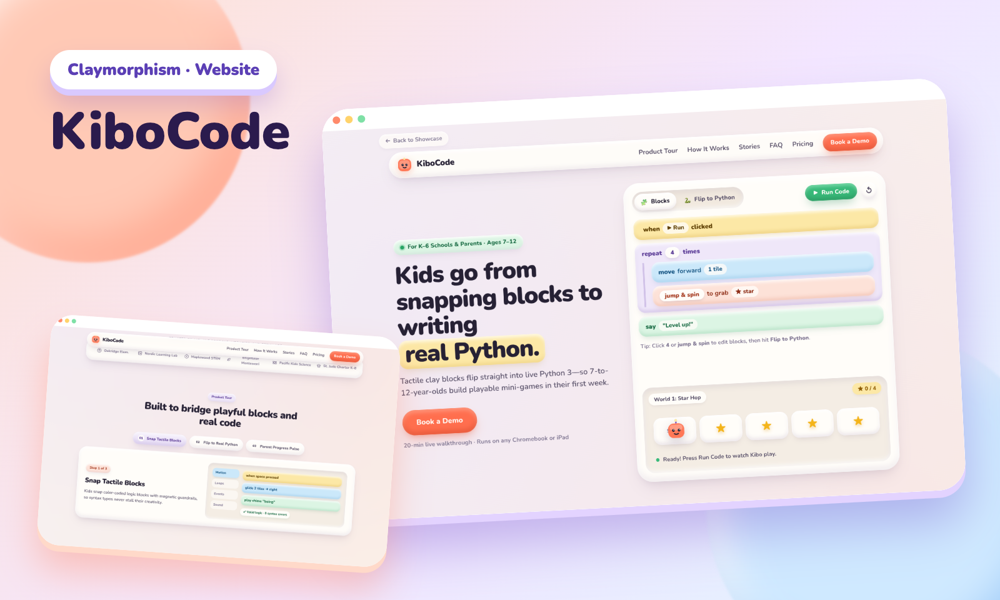](https://allanindrajith.github.io/ui-ux/sites/01-kibocode/) | [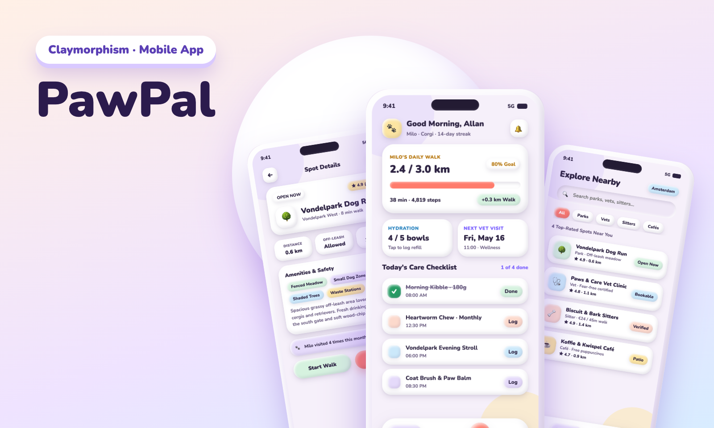](https://allanindrajith.github.io/ui-ux/apps/01-pawpal/) |
| **Bento UI** | [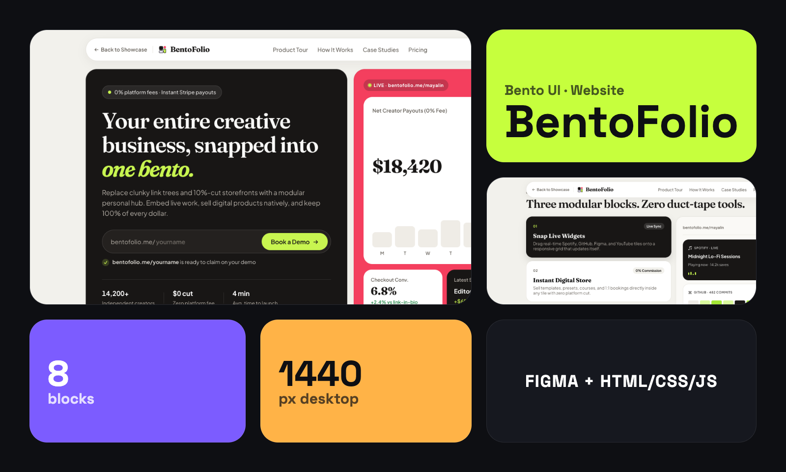](https://allanindrajith.github.io/ui-ux/sites/02-bentofolio/) | [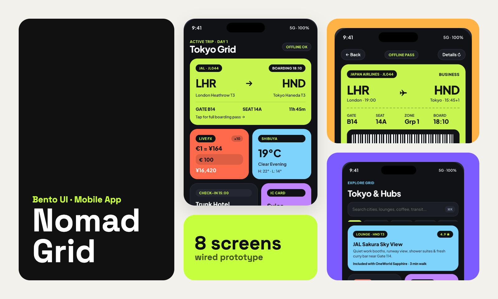](https://allanindrajith.github.io/ui-ux/apps/02-nomadgrid/) |
| **Glassmorphism 2.0** | [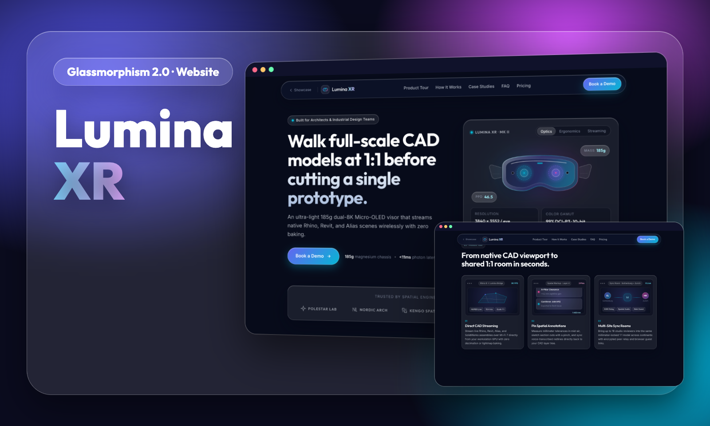](https://allanindrajith.github.io/ui-ux/sites/03-lumina-xr/) | [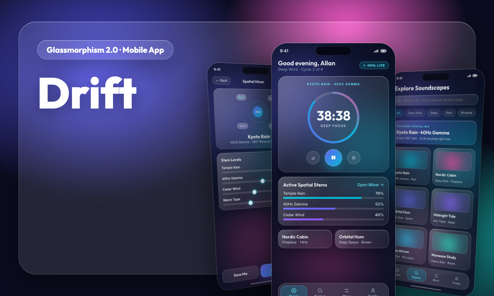](https://allanindrajith.github.io/ui-ux/apps/03-drift/) |
| **Dark Mode Elevation** | [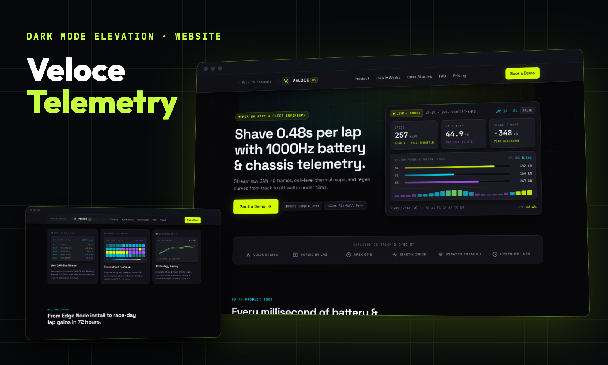](https://allanindrajith.github.io/ui-ux/sites/04-veloce-telemetry/) | [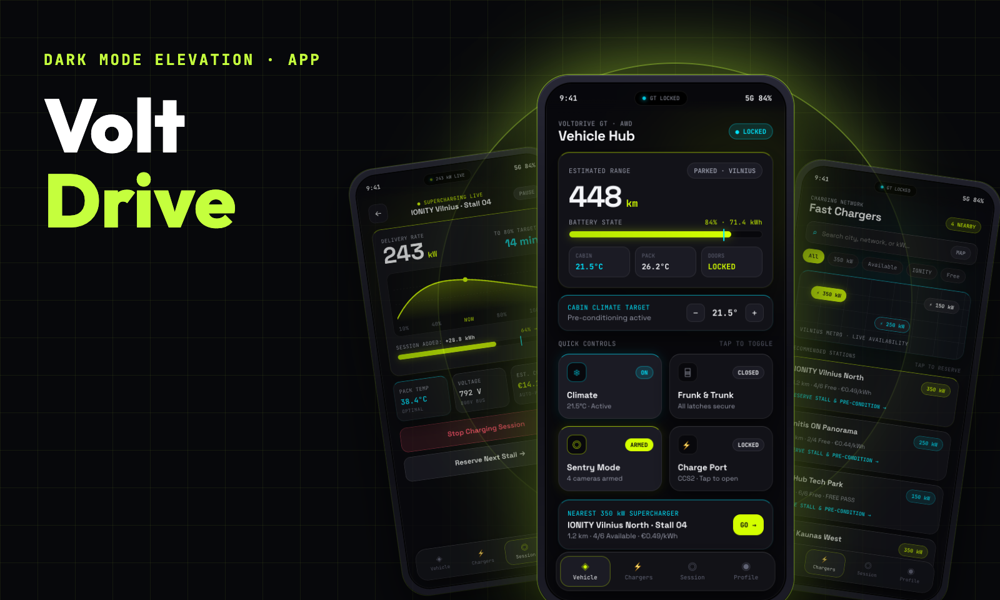](https://allanindrajith.github.io/ui-ux/apps/04-voltdrive/) |
| **3D Soft Realism** | [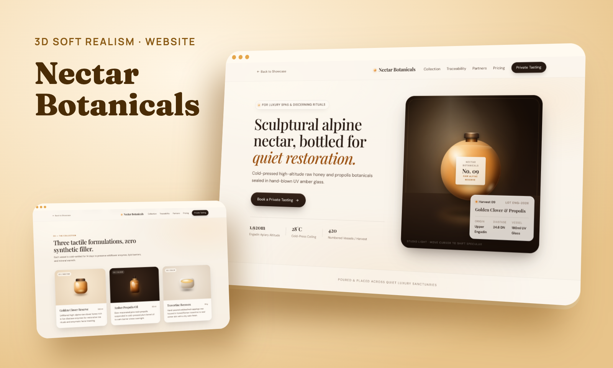](https://allanindrajith.github.io/ui-ux/sites/05-nectar-botanicals/) | [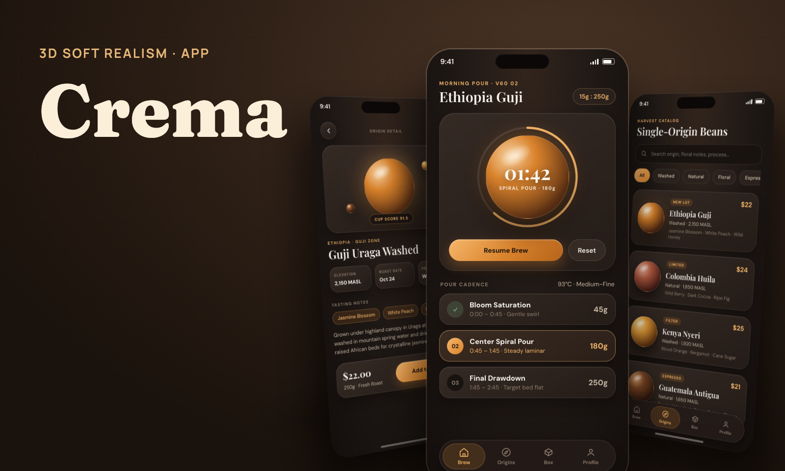](https://allanindrajith.github.io/ui-ux/apps/05-crema/) |
| **Neo-Brutalism** | [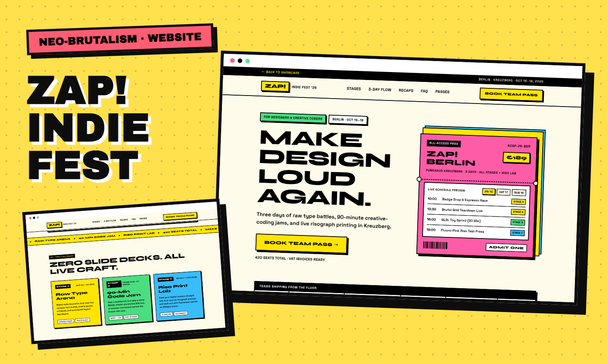](https://allanindrajith.github.io/ui-ux/sites/06-zap-fest/) | [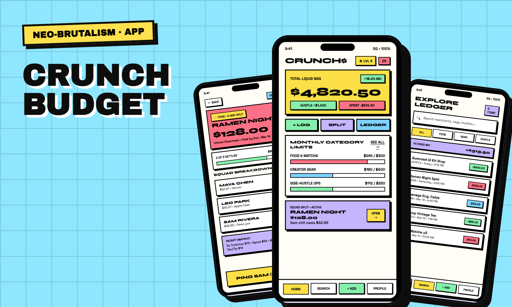](https://allanindrajith.github.io/ui-ux/apps/06-crunch-budget/) |

## The 6 styles

| # | Style | Website (1440px, 8 blocks) | Mobile app (390x844, 8 screens) |
|---|---|---|---|
| 01 | Claymorphism | [KiboCode](https://allanindrajith.github.io/ui-ux/sites/01-kibocode/) | [PawPal](https://allanindrajith.github.io/ui-ux/apps/01-pawpal/) |
| 02 | Bento UI | [BentoFolio](https://allanindrajith.github.io/ui-ux/sites/02-bentofolio/) | [NomadGrid](https://allanindrajith.github.io/ui-ux/apps/02-nomadgrid/) |
| 03 | Glassmorphism 2.0 | [Lumina XR](https://allanindrajith.github.io/ui-ux/sites/03-lumina-xr/) | [Drift](https://allanindrajith.github.io/ui-ux/apps/03-drift/) |
| 04 | Dark Mode Elevation | [Veloce Telemetry](https://allanindrajith.github.io/ui-ux/sites/04-veloce-telemetry/) | [VoltDrive](https://allanindrajith.github.io/ui-ux/apps/04-voltdrive/) |
| 05 | 3D Soft Realism | [Nectar Botanicals](https://allanindrajith.github.io/ui-ux/sites/05-nectar-botanicals/) | [Crema](https://allanindrajith.github.io/ui-ux/apps/05-crema/) |
| 06 | Neo-Brutalism | [ZAP! Indie Fest](https://allanindrajith.github.io/ui-ux/sites/06-zap-fest/) | [Crunch Budget](https://allanindrajith.github.io/ui-ux/apps/06-crunch-budget/) |

Each prototype is plain HTML, CSS and JavaScript. No build step, no dependencies. Open any `index.html` in a browser.

## Figma files

The editable designs are in Figma. See [figma/README.md](figma/README.md) for the 6 files, their prototype links and Figma Community pages.

## Structure

```
index.html, app.js, styles.css   portfolio hub
sites/01-06/                     desktop website prototypes
apps/01-06/                      mobile app prototypes
assets/designs/                  1600x960 preview banners (used by the hub and this README)
figma/                           Figma file links
PROJECTS.md                      full project manifest
```

## License

Code is MIT. Designs are CC BY 4.0, so reuse them with credit. See [LICENSE](LICENSE).
